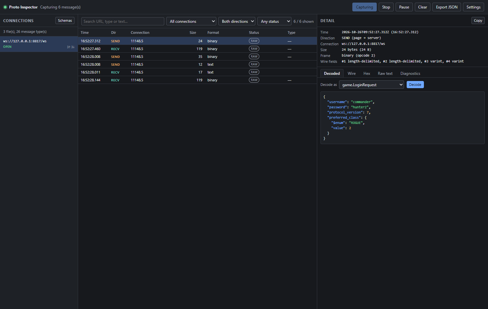
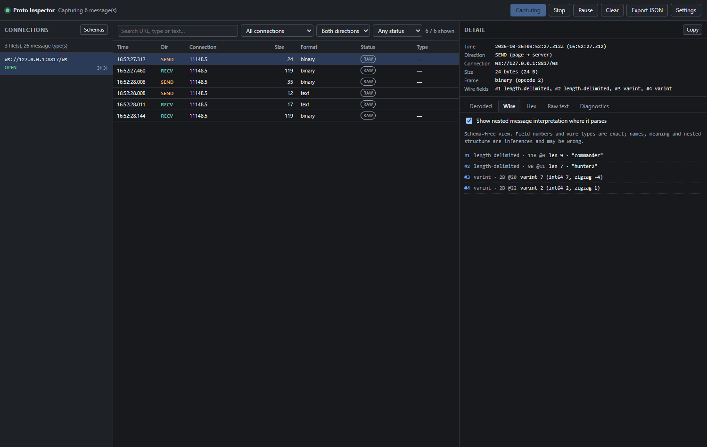
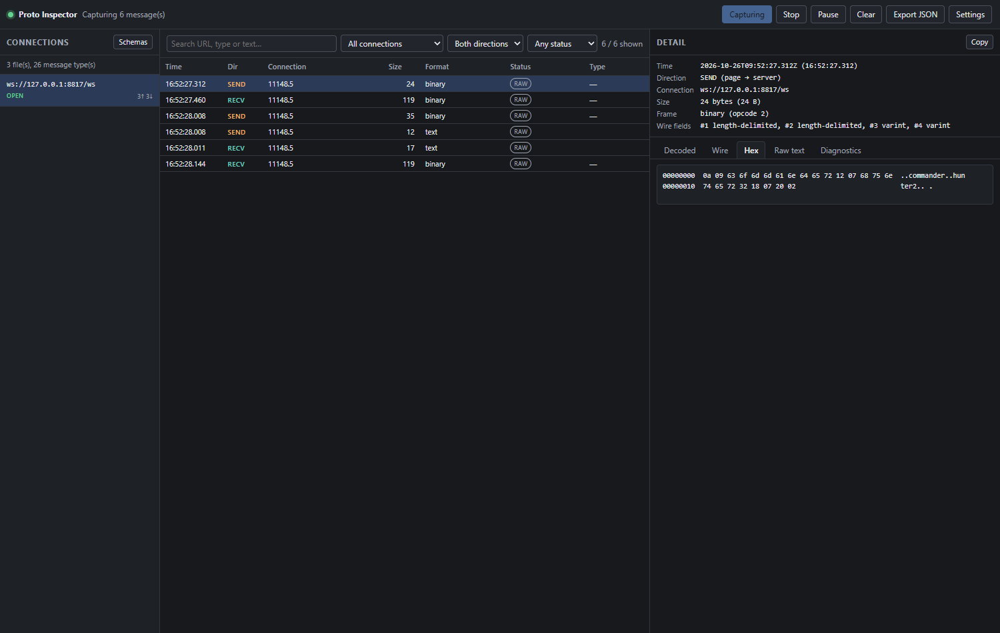

# Proto Inspector

A Chrome DevTools extension for inspecting WebSocket traffic and decoding Protocol Buffers
payloads locally. Everything runs in your browser: no backend, no account, no telemetry.

- **Manifest V3**, TypeScript, vanilla DOM (no UI framework).
- Captures WebSocket connections and frames through the Chrome DevTools Protocol.
- Decodes payloads with your own `.proto` files, or inspects them at the raw wire-format level.
- Never stores captured payloads on disk and never sends them anywhere.

---

## Quick start

```bash
# 1. Node.js 22.12+, 24, or 26
node --version

# 2. Install exactly what the lockfile pins
npm ci

# 3. Run the unit tests
npm test

# 4. Build the loadable extension into dist/extension
npm run build

# 5. Optional: produce dist/proto-inspector-<version>.zip
npm run package
```

Then in Chrome:

1. Open `chrome://extensions`.
2. Enable **Developer mode**.
3. Click **Load unpacked** and select `dist/extension` (not the repository root).
4. Open the site you want to inspect.
5. Open DevTools (**F12**), and select the **Proto Inspector** panel.
6. Click **Start capture**.
7. Open a WebSocket from the page. Connections and frames appear as they arrive.
8. Click **Schemas**, load your `.proto` files, pick a message type in the detail pane and
   press **Decode**.

To try it without your own target, run `npm run sample-server` and open
`http://127.0.0.1:8787/`. That page sends real protobuf frames built with the bundled sample
schemas.

### Reloading after a code change

`npm run dev` rebuilds on every change. After it rebuilds:

1. Open `chrome://extensions`.
2. Click the reload icon on the Proto Inspector card.
3. Reload the inspected page, then close and reopen the DevTools panel.

Reloading the extension detaches the debugger, so click **Start capture** again.

### Screenshots

| Decoded | Wire format | Hex |
| --- | --- | --- |
|  |  |  |

---

## How capture works

### Primary path: Chrome DevTools Protocol

The extension attaches to the inspected tab with `chrome.debugger` and subscribes to the
`Network` domain. This provides, without touching page JavaScript:

| CDP event | Used for |
| --- | --- |
| `Network.webSocketCreated` | Connection URL and discovery time |
| `Network.webSocketWillSendHandshakeRequest` | Handshake request |
| `Network.webSocketHandshakeResponseReceived` | Status, subprotocol, extensions |
| `Network.webSocketFrameSent` | Outgoing frames |
| `Network.webSocketFrameReceived` | Incoming frames |
| `Network.webSocketFrameError` | Per-connection error state |
| `Network.webSocketClosed` | Connection closure |

**Payload encoding.** CDP does not hand back a byte array. Per Chromium's
`inspector_network_agent.cc` (`WebSocketMessageToProtocol`), the `payloadData` field is:

- **opcode 1 (text):** the UTF-8 text, decoded with a *Latin-1 fallback* for invalid
  sequences;
- **every other opcode:** standard **Base64** of the exact bytes.

The extension therefore Base64-decodes all non-text frames (exact byte preservation) and
treats opcode 1 as text. For text frames the original bytes are recoverable only while the
payload really was UTF-8; the panel re-encodes the string and prints a diagnostic when a
Latin-1 fallback is likely. This is documented rather than papered over.

**DevTools coexistence.** Attaching `chrome.debugger` while DevTools is open on the same tab
does work in current Chrome: the framework supports multiple protocol clients, and this was
verified against Chrome for Testing 156 (see *Test results*). Chrome's own documentation still
carries an older "DevTools takes over the debugger" note, so if a future release changes this,
the panel surfaces the real error instead of failing silently.

### Optional page hook

The architecture has a slot for a page-context `WebSocket` instrumentation adapter
(`CaptureMode: "page-hook"`). **It is not implemented.** The CDP path already yields exact
binary bytes, so a second capture mechanism would add risk (patching page APIs) for no gain.
If you need it, implement it as a separate adapter that observes `WebSocket.prototype.send`
and `message` events without modifying payloads, and register it as `page-hook` in
`src/background/worker.ts`.

### What capture does not cover

- **Web Workers and Service Workers.** `chrome.debugger` attaches to a *tab* target, and
  sockets opened inside dedicated, shared, or service workers are separate targets. Do not
  rely on them appearing here; this extension does not subscribe to worker targets.
- **`chrome://`, `devtools://`, and Web Store pages.** Cannot be inspected.
- **Traffic before the panel attached.** Only frames after `Network.enable` are delivered.
- **Tabs other than the inspected one.** Each DevTools panel attaches only to its own tab.
- **Encrypted, compressed, or otherwise wrapped payloads.** Shown as-is and diagnosed, never
  decrypted or decompressed.

---

## The panel

- **Connections**: URL, state (`connecting` / `open` / `closed` / `error`), discovery time,
  and send/receive counts. Select one to filter.
- **Messages**: time, direction (`SEND` / `RECV`), connection, size, frame format, decode
  status and message type. Search plus connection/direction/status filters. Pause, resume,
  clear, and JSON export.
- **Detail**, five tabs:
  1. **Decoded** — JSON from your schema.
  2. **Wire** — schema-free field view (field number, wire type, raw value, nested guess).
  3. **Hex** — exact bytes as an offset/hex/ASCII dump.
  4. **Raw text** — text frames verbatim.
  5. **Diagnostics** — ids, timings, handshake details, and the exact decode error.

Rendering is capped at the newest 500 rows; the counter always states how many are shown and
how many were evicted, so nothing is silently dropped.

---

## Protobuf decoding

### Schema-based

`protobufjs` parses `.proto` files and provides reflection. **Message decoding is not done by
protobufjs's generated decoder**, because that uses `new Function`, which Manifest V3's
Content Security Policy forbids. Instead `src/protobuf/schema.ts` walks the reflected
descriptors with `protobuf.Reader`.

Supported: proto2 and proto3, packages, nested messages, repeated fields (packed and
unpacked), maps (including non-string keys), `oneof`, enums, groups, all scalar types, imports
between uploaded files, and the bundled `google/protobuf/*` well-known types.

### Lossless JSON

Numbers are never silently rounded:

| Protobuf value | JSON |
| --- | --- |
| `int64` inside ±2^53−1 | number, e.g. `42` |
| `int64` outside the safe range | `{"$number":"18446744073709551615"}` |
| `double` NaN / ±Infinity | `{"$number":"NaN"}` |
| `bytes` | `{"$bytes":"<base64>","byteLength":3}` |
| enum | `{"$enum":"ROGUE","value":2}` |
| unknown enum number | `{"$enum":null,"value":99}` |
| map with integer keys | `[{"key":7,"value":"seven"}]` |

Absent fields are omitted; a field that is present with its default value is shown. Those are
different things and are kept distinguishable.

### Schema-free wire format

`src/protobuf/wire.ts` is an independent parser (no protobufjs) that reports field numbers,
wire types, varints (with signed and zigzag interpretations), fixed32/fixed64, groups, and
length-delimited payloads with their byte length and optional nested interpretation.

It rejects, with the byte offset of the failure: truncated varints, varints longer than 10
bytes, field number 0, field numbers above 2^29−1, unsupported wire types, lengths past the end
of the message, unterminated or mismatched groups, oversized messages, excessive field counts,
and excessive nesting. Schema-free inspection **cannot** infer field names, application types,
or whether a length-delimited field is a nested message; the UI says so.

### Application envelopes (optional)

Some protocols prefix a header and a message id. The **Settings → Application envelope** panel
configures this *without* touching the decoder:

- header length and payload offset (bytes),
- optional message id at an offset, encoded as `uint8`, `uint16le/be`, `uint32le/be`, or
  `varint`,
- a mapping from message id to message type.

Only the remaining bytes are handed to the protobuf decoder. This is configuration, not
reverse engineering: it cannot decode encrypted or compressed traffic.

---

## Privacy and permissions

Permissions declared: `debugger`, `storage`, `tabs`. No host permissions.

| Concern | Behaviour |
| --- | --- |
| Data leaves the machine | Never. No network calls, no analytics, no telemetry. |
| Captured payloads persisted | Never. Frames live in the service worker's memory only. |
| Console logging of payloads | Never logged. Errors carry messages, not bodies. |
| Export | Only on an explicit **Export JSON** click, to a local file. |
| Scope | Only the tab that opened the DevTools panel. |
| Storage | Preferences and `.proto` **text** only, in `chrome.storage.local`. |
| Schema execution | `.proto` text is parsed, never evaluated as JavaScript. |
| Payload execution | Never. Captured data is rendered as text nodes, never as HTML. |
| Cleanup | State is cleared on **Clear**, on page navigation, and on tab close. |

`chrome.debugger` shows Chrome's "started debugging this browser" notification while attached,
and can conflict with other tools that attach to the same tab. Both are surfaced in the UI.

Exported files contain raw application data. Treat them as sensitive.

---

## Configuration

Preferences are stored in `chrome.storage.local` under `protoInspector.settings` and schema
sources under `protoInspector.schemas`. Both are re-validated on read: a hand-edited or stale
value falls back to defaults instead of breaking the panel.

| Setting | Default | Range |
| --- | --- | --- |
| Retention limit | 5000 messages | 100 – 50000 |
| Nested wire depth | 16 | 1 – 64 |
| Automatic decoding | on | — |
| Default message type | none | any loaded type |

---

## Architecture

```
src/
  manifest.json           MV3 manifest (debugger, storage, tabs)
  devtools/               DevTools page: registers the panel, passes the tab id
  background/worker.ts    Owns chrome.debugger + per-tab capture stores; CDP only here
  capture/
    cdp-frames.ts         CDP payloadData → exact bytes / text (Base64 vs UTF-8)
    targets.ts            Event payload parsing and validation
    store.ts              Bounded in-memory store with retention and counters
  protobuf/
    wire.ts               Schema-free wire-format parser with limits
    schema.ts             .proto loading + CSP-safe reflection decoder
    envelope.ts           Optional fixed header / message id handling
    json-value.ts         Lossless int64 / bytes / enum JSON projection
  panel/
    panel.ts              DOM controller (no innerHTML anywhere)
    decode-service.ts     envelope → schema → wire pipeline (DOM-free, testable)
    format.ts             Presentation + export document builder
  storage/                Settings and schema persistence with validation
  schemas/                Sample .proto files
scripts/
  build.mjs               esbuild bundle → dist/extension (+ icons, manifest check)
  package.mjs             ZIP writer → dist/proto-inspector-<version>.zip
  sample-server.mjs       Local WebSocket + protobuf test target (no dependencies)
  make-fixtures.mjs       Regenerates tests/fixtures/payloads.json
tests/
  *.test.ts               Unit tests (Vitest)
  fixtures/payloads.json  Payloads encoded by protobufjs, used as independent fixtures
  e2e/                    Real-Chrome integration tests
```

The panel never touches `chrome.debugger`; the worker never renders. Decoding lives in
DOM-free modules so it can be tested directly.

---

## Testing

```bash
npm run typecheck   # tsc --noEmit (strict, noUncheckedIndexedAccess, exactOptionalPropertyTypes)
npm test            # 139 unit tests
npm run test:e2e    # real Chrome: needs Chrome for Testing (see below)
npm run build
```

The end-to-end tests load the built extension into a real Chrome, open the sample page, start
capture from the panel, and assert on captured frames, decoding, filtering, export and
malformed input.

Extensions cannot be loaded from the command line in branded Chrome. Install Chrome for
Testing once:

```bash
npx @puppeteer/browsers install chrome@stable --path "$TMPDIR/cft"
# or set CHROME_PATH to any Chromium build that allows --load-extension
```

### Test results (this repository)

| Check | Result |
| --- | --- |
| `tsc --noEmit` | passes |
| Unit tests | **139 passed**, 5 files |
| `npm run build` | produces `dist/extension`; manifest references verified |
| `npm run package` | ZIP integrity verified, 13 files |
| `npm audit` | 0 vulnerabilities |
| e2e `panel-smoke` | **24/24 checks passed** — capture, send/receive counts, schema decode, enum rendering, wire view, hex view, text frames, search filter, settings persistence, malformed frames, CSP enforcement, pause/resume, JSON export, clear, stop |
| e2e `devtools-panel` | **passed** — 2 frames captured with a real DevTools window open on the same tab |

The e2e run also asserts that the extension page's CSP really blocks inline scripts while
schema decoding still succeeds — the property that motivated writing a reflection decoder
instead of using protobufjs's `Function()`-based one.

---

## Troubleshooting

| Symptom | Cause and fix |
| --- | --- |
| Panel says "Could not determine the inspected tab" | Close and reopen the Proto Inspector panel. |
| "Another debugger is already attached" | Another tool (or another DevTools session) owns the tab. Close it and press **Start capture**. |
| "This tab cannot be inspected" | `chrome://`, `devtools://` and Web Store pages cannot be attached to. |
| No connections appear | Capture must be started **before** the page opens the WebSocket. Start capture, then reload the page. |
| Connection exists but no messages | The socket is idle, or it lives in a Worker (see limitations). |
| "This payload is not valid protobuf" | The frame is text, Base64-wrapped, encrypted, or a different protocol. Check the Hex tab and the envelope settings. |
| Decode error naming a field | The selected message type does not match the payload; try another type. |
| Panel is empty after reloading the extension | Open DevTools again; the old panel's port no longer exists. |

---

## Known limitations

- **Workers are not captured.** Sockets opened in dedicated, shared, or service workers are
  not reported by the tab-level debugger attachment.
- **The page hook is not implemented.** Only the CDP adapter exists.
- **Text frames are not byte-exact.** CDP hands back a decoded string; original bytes are
  recoverable only for valid UTF-8 (see *Payload encoding*).
- **No request/response payloads, SSE, or WebTransport.** Only the WebSocket event family is
  subscribed.
- **Schema-free nesting is a guess.** A length-delimited field is only *shown* as nested when
  its bytes happen to parse as a message; it may be `bytes` or a string.
- **No `.proto` import from disk paths.** Files must be uploaded (drag-free file picker);
  imports resolve against the uploaded set and the bundled well-known types.
- **No proto3 optional-presence distinction** beyond what wire data shows; omitted fields are
  simply absent.
- **No debuggable partial captures across worker restarts.** If Chrome terminates the
  service worker, in-memory frames are lost; the panel reconnects and starts clean.
- **Closing the panel releases the debugger on a best-effort basis.** The worker detaches when
  the panel's port disconnects, but Chrome's port teardown timing is not guaranteed. If a
  capture ever appears stuck, press **Stop**; Chrome also releases the attachment when the tab
  is closed.
- **Retention is in-memory only.** Exported JSON is the only way to keep data.
- **No decompression / decryption.** Wrapped payloads are reported, not decoded.

---

## License

Source provided as-is for authorized debugging and testing of applications you own or are
permitted to inspect.
